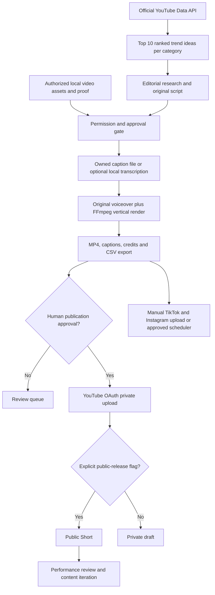

# TrendTide 60 — Automated Viral-Topic-to-Original-Shorts Studio

**Project:** `auto_viral_YT`  
**Target Windows workspace:** `D:\auto_viral_YT\`  
**Repository:** https://github.com/ImranBigDataEngg/viral_yt  
**Plan date:** 2026-11-19  
**Primary goal:** build a low-cost, scalable, copyright-conscious creator workflow that can generate monetizable **original** short-form content about trending subjects.

## 1. Executive decision

Do **not** implement "download anyone's popular YouTube videos, snip, and automatically reupload" as the core monetization model. Public accessibility is not permission to redistribute footage, transcripts, music, performances, or game trailers. Attribution, a crop, a watermark, subtitles, and arbitrary speed changes do not grant rights or guarantee compliance with YouTube's reused-content rules.

**Recommended strategy:** trend research -> editorial angle -> permitted/owned footage and source materials -> genuinely original commentary/explanation -> 9:16 render -> review -> YouTube Shorts publication -> download manifest for cross-posting -> analytics and iteration. A rights-compliant third-party clip can be incorporated when the specific right to edit, monetize, and redistribute it on each platform is documented. Do not assume fair use; it is case-dependent, and YouTube monetization review is independent of copyright clearance.

## 2. Branding and channel creation

- **Proposed display name:** **TrendTide 60**. Pronounced "trend tide sixty"; it covers any category without promising stolen viral content. Proposed handle: `@TrendTide60` (**availability unverified; reserve manually**).
- **Tagline:** Today's biggest trends. Explained in 60 seconds.
- **Positioning:** explain *why* a clip, reveal, product, game, cultural moment or news item is trending. Give original perspective; avoid unverified claims.
- **Initial three playlists:** Gaming & GTA; AI & Technology; Viral Culture & Entertainment.
- **Channel description:** "TrendTide 60 breaks down the biggest stories in gaming, AI, technology, and internet culture in quick, original, easy-to-follow videos. New explainers, facts, context, and trend breakdowns. Independent commentary; source credits in each description."
- **Channel creation is manual:** Sign in to YouTube with the intended Google account, create a channel, verify, reserve a handle, add brand assets and channel description, enable 2-factor authentication, and review community/copyright settings. YouTube Data API does not provide a general channel-creation endpoint. This project cannot silently create or own your YouTube account.

## 3. Project scope and implementation status

| Phase | Deliverable | Current repository status | Gate |
|---|---|---|---|
| P0 | GitHub repo, docs, master prompt, Windows setup | Included | Local extraction required |
| P1 | YouTube official-API trend search; 10 ranked ideas per category; CSV/JSON | Implemented | User's YouTube Data API key |
| P2 | Explicit permission ledger for local footage; captions from owned files / local speech recognition | Implemented | Rights evidence and approved asset |
| P3 | FFmpeg 9:16 MP4 creation, optional narration mixing, downloadable manifest | Implemented | FFmpeg and authorized source footage |
| P4 | OAuth YouTube upload as private; public upload behind explicit gate | Implemented, unverified against live account | Local OAuth credentials and permission |
| P5 | TikTok and Instagram auto-posting | Future integration only | Approved provider APIs / account permissions |
| P6 | Workflow scheduling, retention data, higher quality selection, optional self-hosted dashboard | Starter scheduler included; advanced features planned | Persistent Windows machine or always-on runner |

**Not yet completed:** live channel registration, live Google OAuth authorization, real API discovery, third-party account authorization, live published Shorts, and live analytics results. Do not report these as accomplished.

## 4. End-to-end flow

## 5. Trend discovery specification

**Categories:** gaming, AI, technology, entertainment, and internet culture. Seed terms in `config/topics.json`, including GTA 6. These are *queries*, not claims that GTA 6 currently dominates the charts.

- Query `search.list` with `q`, `type=video`, `publishedAfter` (7-day rolling by default), and `order=viewCount`; then enrich returned IDs with `videos.list(part=snippet,statistics,contentDetails)`.
- Derive relative velocity = viewCount/max(hours since publication, 1), rank with engagement signal, time recency, and avoid duplicate video IDs.
- Record search metadata, source link, published timestamp, view/like/comment counts, rank, score, description, creator and search term. Display "ranked candidate", not verified viral status.
- Return up to 10 items per category, not a hard guarantee of 10 matches. Store original records and score assumptions.
- Data API quotas: `search.list` costs 100 units; `videos.list` typically 1 unit. Start at 5 searches/day plus enrichment rather than hundreds; monitor actual quota in Google Cloud. `mostPopular` is a separate chart signal but changed in July 2025, so do not equate it to the discontinued Trending Now tab.
- Rate-limit, retry transient failures (429/5xx), deduplicate, and avoid scraping or bypassing API restrictions.

## 6. Asset rights and script governance

`media/authorized/assets.csv` records `asset_id`, `source_file`, `rights_basis`, `rights_evidence`, optional external source URL, caption and commentary files, clip boundaries, and `approved` / `publish_approved`. Only `original`, `licensed`, `public_domain`, and `cc_by` are accepted rights categories. `rights_evidence` is mandatory; content in a list is not automatically verified as legal.

**Editorial rules:** independently verify important facts; cite sources in descriptions; write your own hook, explanation, examples, and takeaway. Add voiceover/analysis where possible. Avoid misleading titles, AI-generated fake breaking news, fake celebrity endorsements, unlicensed music, and defamatory allegations. Disclose realistic altered/synthetic content as required by each platform.

**Transcript handling:** The YouTube captions API is not a universal transcript service; downloading caption tracks typically requires permission to edit the video. For authorized local files, provide your own `.srt`, or optionally transcribe them offline using `faster-whisper` with its model-download caveat. Never treat online transcript availability as permission to reuse it or the video.

## 7. Rendering, export, and publishing

- Default clip target: 20–60 seconds, adjustable 6–180 seconds subject to Shorts policy and edit quality. 1080×1920, H.264/AAC MP4, 30 FPS, portrait center-crop; optional hard-subtitles if SRT available.
- Persist all results and upload records outside GitHub (`output/` and `media/` are gitignored). Generate `output/manifests/download_manifest.csv` containing Windows-friendly local file URIs. These **are not remotely downloadable** unless you separately upload assets to a storage service and set up access-controlled links.
- Upload with OAuth desktop application, minimal `youtube.upload` scope, separate `.secrets/client_secret.json` and `.secrets/token.json` not committed. Default upload privacy is `private`; `--execute` is required for a real network upload; `--publish` additionally demands `publish_approved=true`.
- Publishing to TikTok/Instagram is **not** implemented. Later use official supported APIs or an approved scheduler, verify the rights and music rules for each destination, and never rely on browser credential automation.

## 8. Windows deployment and operation

1. Download or clone this repo into `D:\auto_viral_YT\`.
2. Install Python 3.11+ and FFmpeg (`winget install Gyan.FFmpeg` where available), ensure `ffmpeg` and `ffprobe` are in PATH.
3. Run `powershell -ExecutionPolicy Bypass -File .\scripts\install_windows.ps1` from the project directory.
4. Set `YOUTUBE_API_KEY` in `.env` after enabling YouTube Data API v3 in a Google Cloud project.
5. Run `python -m viral_yt.cli discover --top 10` to create trend CSV/JSON.
6. Populate `media\authorized\assets.csv` from `examples\assets_template.csv` with **local source files you own or have documented authorization to reuse**.
7. Run `python -m viral_yt.cli render --asset-id YOUR_ID` and `python -m viral_yt.cli manifest`.
8. For upload, configure Google OAuth desktop client in `.secrets`, run `python -m viral_yt.cli upload --asset-id YOUR_ID` for validation then add `--execute` to upload privately. Add `--publish` only with confirmed publication approval.
9. Schedule safe discovery with `scripts\schedule_discovery.ps1` using Windows Task Scheduler; keep publishing as separate approval-gated command.

**Caution:** A Windows desktop can run a scheduled job only while powered on/available; GitHub Actions are not a free unlimited video-render farm and secrets must never be committed. An always-on computer/server is required for truly unattended local rendering.

## 9. Quality and acceptance criteria

- [x] Repo plan and master prompt supplied
- [x] Python package, CLI, example manifest, tests, and environment template
- [x] Trend discovery returns candidates and writes CSV/JSON (requires live API key)
- [x] FFmpeg clip generator accepts locally authorized video and exports manifest
- [x] Upload requires explicit execution and publication approval; default private
- [ ] Actual YouTube channel and handle reserved
- [ ] User's Google OAuth keys configured and live upload tested
- [ ] A genuinely original first GTA 6 commentary Short created from cleared material
- [ ] Publishing and monetization policy reviewed for each clip
- [ ] Instagram/TikTok official API integration and monitoring added
- [ ] 30-day metrics review and retention-driven content experiments

## 10. Growth and monetization roadmap

**Week 1:** channel setup, 3 topic verticals, 15 independent scripts, 5 polished Shorts and 1 original 5–8 minute explainer. Avoid 10 copies of the same formula or creator's footage.  
**Weeks 2–4:** 1–2 original Shorts per day if sustainable, measured hooks, titles, first 3 seconds, average view duration and subscribers per 1,000 views. Test series and CTA, source credits and clearance.  
**Months 2–3:** one weekly long explainer to build watch-hours, sponsorship/affiliate options with disclosures, optimize based on analytics and channel value, and apply for YouTube Partner Program when eligibility thresholds and policy review are satisfied. **No income is guaranteed.**

As of Nov 2026, a common full Shorts-ad revenue YPP path requires 1,000 subscribers and 10 million qualified public Shorts views in 90 days; an alternative long-form pathway uses 4,000 public watch hours in 12 months. Earlier tier eligibility and feature eligibility differ. Check YouTube Studio Earn for local/current details. Shorts Feed watch time does not count toward the 4,000 long-form hours.

## 11. Risk register

| Risk | Mitigation |
|---|---|
| Copyright claims or strikes | Evidence ledger; cleared footage, music, voices; platform-specific license checks |
| Reused/mass-produced content rejection | Original scripts, narration, insight, editing; editorial review |
| API limitations or quota burn | Low-cost batching, dry runs, cache files, 5 searches/day starting point |
| Compromised OAuth tokens | `.secrets/` out of repo, least privilege, credential rotation, no password scraping |
| Platform upload changes | Official documented APIs, manual fallback, isolated uploader module |
| AI misinformation | Source checking, disclosure, human release approval |
| Storage fill/disk wear | Local retention window, backups, quotas, archive output externally |
| 0 views/revenue | Experiment with audience niches and publish long-form original videos too |

## 12. References (reviewed 2026-11-19)

- YouTube channel monetization policy: https://support.google.com/youtube/answer/1311392
- YouTube Partner Program: https://support.google.com/youtube/answer/72851
- YouTube API quota calculator: https://developers.google.com/youtube/data/determine_quota_cost
- YouTube Data API search.list: https://developers.google.com/youtube/v3/docs/search/list
- YouTube Data API videos.list: https://developers.google.com/youtube/v3/docs/videos/list
- YouTube Data API videos.insert: https://developers.google.com/youtube/v3/docs/videos/insert
- YouTube captions.download restrictions: https://developers.google.com/youtube/v3/docs/captions/download
- Shorts upload guidance: https://support.google.com/youtube/answer/12779649
